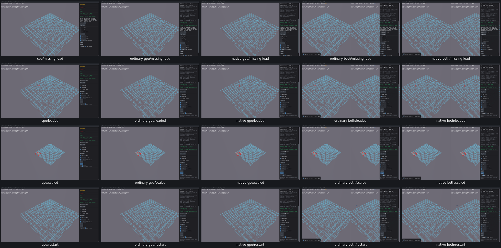

# UI26 — Preserve Tree Load recovery

- [x] Fixed and verified locally on all five viewer routes, real Box3D CPU first.

Tree Benchmark destroyed its current tree before loading `tree.dt`. A missing file returned an empty tree, after which the sample hid all recovery controls and showed no visible error.

The generated native sample now loads a temporary candidate. A failed load preserves the live tree, proxy metadata and statistics and displays an actionable error. A valid load replaces the tree and clears the error; File rebuild and restart also clear it. The native tree algorithms, geometry/defaults and Box3D source are unchanged. Bun generates the repaired class through the native CMake build.

The [acceptance receipt](ui26-acceptance.json) records 95 checks across five routes: 15 missing/empty/version-invalid load attempts preserve the original 288 proxies, bounds and leaf digest; 10 valid loads retain or correctly scale geometry, and actual overlap queries and restart remain usable. All four after states and original CPU-first before images were inspected. Error text is visible after failure and clears after valid loading on every route.

Three CPU text-list assertions were invalid because the existing observer does not wrap `ImGui::TextWrapped`. Actual error pixels and recovery controls were inspected; native tree checks passed. Those false flags remain preserved in [adjudication](ui26-cpu-text-adjudication.json), with no CPU app repetition. The four GPU routes use native recovery-control checks and visual error/clearing evidence. All three failed-result cases share the same visible-error branch.

All five original Tree modules were byte-identical, so one repaired class compile was reused and actually exercised in five viewers. All 17 recorded producer/viewer PIDs are absent, no owned cores exist, cache growth is zero and all task-owned `tree.dt` files were consumed. Selected evidence is 13,184,872 bytes; the whole raw tree is 877,439,451 bytes. Superseded viewers and consumed streams/logs were removed.

Limits: arbitrary corrupt headers, pointers and node graphs are not newly qualified; this is not native parser hardening. The sample has no physics bodies or picking target. No solver/full query qualification is claimed. Box3D/WASM/Rust/WGSL/shared archives are unchanged. PR10 remains unchecked pending remaining repairs, compatibility checks, affected-scene recordings and the criterion audit; no commit/push.
