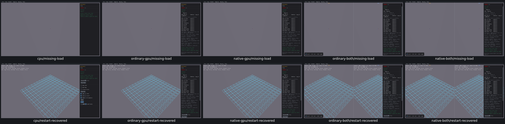

# UI26 — failed Tree Load removes recovery controls

Status: fixed and verified locally; original diagnosis below is historical. On all five routes, clicking Load with no `tree.dt` destroys the current tree. The actual load returns an empty tree, File and the other controls disappear, and no visible error is shown. Global restart restores the 288-proxy default tree. [Actual checks and failure/recovery evidence](tree-missing-file-acceptance.json).

The shared native TreeBenchmark::LoadTree destroys the live tree before loading; DrawControls returns early when proxyCount is zero. Failure is printed to stderr only. This is a shared sample-host issue, including real Box3D CPU; the physics engine is unchanged. Preserve the existing scene on failed loads and keep a visible recovery/error path when repairing after review.

Verified repair: [Tree Load failure recovery](UI26-repair.md). Generated native Tree class loads into a temporary candidate; failed missing/empty/version-invalid loads preserve288proxies/bounds/leaf digest and show visible actionable error. ValidLoad/.5scale/actual overlap queries/defaultrestart pass allfive routes.95recordedchecks;3CPUTextWrapped item-list flags adjudicated from same pixels/source branch,0CPUreruns. One class compile reused afterallfive originalmodule identity proof. No native algorithm/engine/WASM changes.
