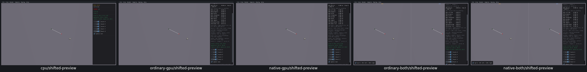
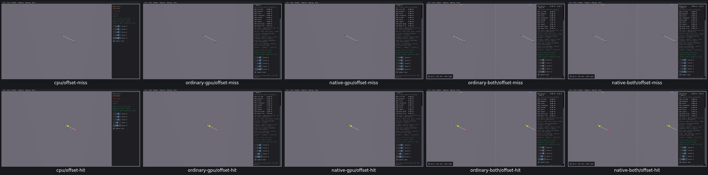

# UI27 — Position Mesh Scale sphere previews from their cast start

- [x] Fixed and verified locally on all five routes, real Box3D CPU first.

Mesh Scale cast its sphere from `m_start` but drew the preview from zero. A miss from `[-2,1,1]` with translation `[4,0,0]` therefore drew at `[4,0,0]`, instead of the endpoint `[2,1,1]`. The hit branch also omitted the start.

The generated native class now uses `b3OffsetPos(m_start, displacement)` for both preview transforms. Hits use the sample's actual returned fraction times translation; misses use the full translation. The query, callback result, mesh geometry, native defaults and body/shape identities are unchanged.

The [acceptance receipt](ui27-acceptance.json) records 230 passing checks and 40 native preview cases: 35 hits and five misses across real CPU, ordinary/native GPU and both combined viewers. A read-only local probe records actual callback count/fraction and transform. The independent existing `DrawSolidSphere` observer agrees with start plus displacement in all 40 cases. Offset hits, misses, restoration, UI23 zero-scale handling, ray/sphere mode and restart pass with stable identities, poses, mass and counts.

All three CPU-first grids were inspected, including [default/zero-scale/restart regressions](ui27-regressions-grid.png). One generated C++ class was compiled and five viewers relinked. All 17 recorded PIDs are absent, no owned cores exist and cache growth is zero. Selected evidence is 5,666,747 bytes and the whole raw tree is 881,831,581 bytes; superseded viewers/class inputs and consumed streams/logs were removed.

Limits: each route uses its own actual callback fraction; CPU/GPU query-numeric equality and ordering are PR11 work. Mesh Scale is intentionally query-only and does not draw the world mesh. Runs were paused; no solver/trajectory qualification is claimed. Box3D/WASM/Rust/WGSL/shared archives are unchanged. PR10 compatibility, final recordings and criterion audit remain open; no commit/push.
