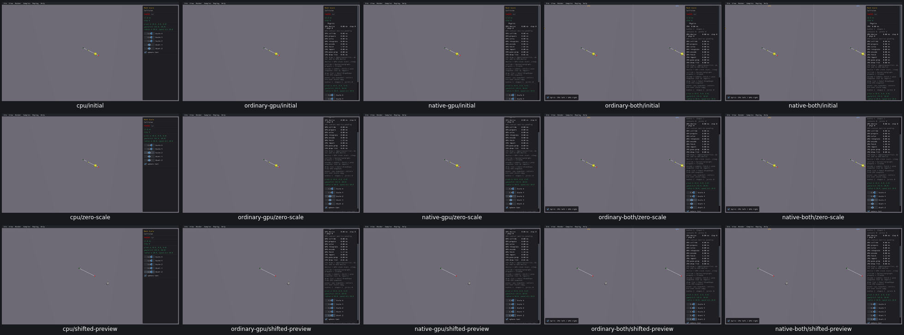

# UI27 — Mesh Scale sphere preview omits its cast start

- [x] Fixed and verified locally; original diagnosis below is historical.

On all five routes, Start Y=1 and Start Z=1 produces a miss for the actual sphere cast from[-2,1,1] with translation[4,0,0]. The preview sphere is drawn at[4,0,0] instead of the endpoint[2,1,1]. The actual query inputs/zero callbacks and DrawSolidSphere transform are retained in [acceptance](query-input-controls-acceptance.json).

MeshScale::Step uses fraction*translation on hit and translation on miss without adding m_start. The miss branch is demonstrated on real CPU, ordinary/native GPU and both combined routes; the hit branch shares the omission by source and requires verification during repair. This is shared sample-host drawing; no query numerical result or engine change is requested.

Verified repair: [Mesh Scale sphere preview positions](UI27-repair.md). Generated native MeshScale hit/miss sphere transforms add m_start with b3OffsetPos, preserving actual query inputs/results/mesh/defaults/body+shapeIDs. FiveCPUfirst routes/40nativepreview cases (35hits5misses)/40independentDrawSolidSphere comparisons/230passingchecks. Offsethit/miss/restoration/UI23zeroScale/raymode/restart pass; no querynumerics/solver matching required.
