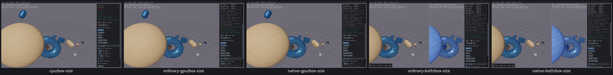
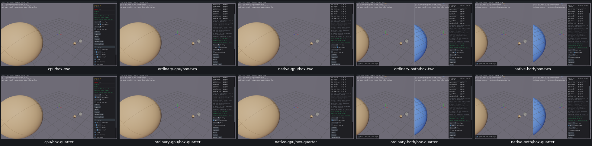

# UI28 — Expose the active Box cast size

- [x] Fixed and verified locally on all five routes, real Box3D CPU first.

Cast World used the shared radius value as Box half-width, but hid its slider when Box was selected. Sphere Radius=2 therefore produced a Box with half-extents `[2,1,0.5]` that could not be edited in Box mode.

The generated native UI now displays the same existing value as **Half-width** for Box and **Radius** for Sphere/Capsule. Ray hides it. The default 0.5, range 0.1–2, proxy geometry, native queries and scene bodies are unchanged.

The [acceptance receipt](ui28-acceptance.json) records 175 checks and 40 native proxy cases across five routes, including 25 eight-point Box cases. Actual corners match half-extents `[r,0.5r,0.25r]`; Sphere/Capsule use the same current radius. Ten spawned spheres retain their IDs, poses, mass, geometry and counts through all size changes. Default restart and mode transitions pass.

All three CPU-first grids were inspected, including [Capsule/Ray/restart regressions](ui28-regressions-grid.png). The focused repair fixture uses ten spheres; the original full-review before images use 32 mixed shapes. The Box caster size/type is matched; the background populations are not claimed identical. Product code changes only the slider condition and label.

One CPU assertion incorrectly demanded `CastRayClosest`; this sample uses callback-based `CastRay`. Its fresh Ray UI confirms hidden size labels, while the unchanged Ray operation inherits the earlier actual CPU control evidence. The fresh CPU Ray query/ID snapshot was not saved and is not claimed. All four GPU Ray snapshots directly verify the correct operation and stable identities. The original false flag is retained in [adjudication](ui28-cpu-ray-adjudication.json), with no CPU rerun. A derived before-grid key initially produced explicit placeholders; it was corrected from preserved original screenshots without app/capture repetition.

One C++ class was compiled and five viewers relinked. All 17 recorded PIDs are absent, no owned cores exist and cache growth is zero. Selected evidence is 13,046,189 bytes and the raw tree is 891,914,951 bytes; superseded inputs/viewers and consumed streams/logs were removed.

Limits: proxy-input/UI verification does not qualify query numerics, ordering or solver behavior. Box3D/WASM/Rust/WGSL/shared archives are unchanged. UI03, compatibility, final recordings and the PR10 criterion audit remain open; no commit/push.
