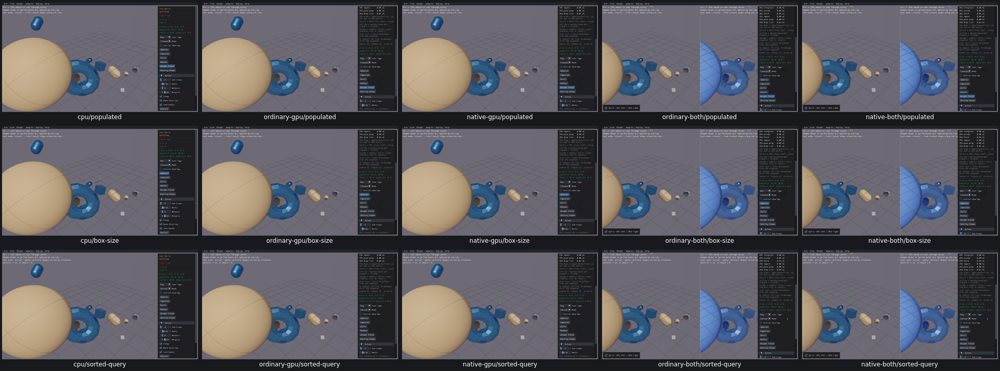

# UI28 — Cast World hides its active Box size

- [x] Fixed and verified locally; original diagnosis below is historical.

After Radius=2 in Sphere mode, selecting Box hides Radius but the actual eight-point cast proxy uses half-extents[2,1,.5]. This happens on real CPU, ordinary/native GPU and both combined routes. The active size cannot be edited while Box is selected. [Actual inputs and UI state](cast-controls-acceptance.json).

DrawControls excludes both Ray and Box from the Radius slider. Step builds Box extent from m_castRadius. Repair the shared native host UI after review, preserving geometry/defaults/physics/bodyidentity; Box3D source remains unchanged.

Verified repair: [Editable Box cast half-width](UI28-repair.md). Generated CastWorld shows same size binding asHalf-width forBox/Radius forSphere+Capsule, hidden forRay; default.5/range.1–2/geometry unchanged. FiveCPUfirst routes/40nativeproxy cases/25eightpointBoxcases verifyactualcorners/radius plus10sphere IDs/poses/mass/counts/restart.175recordedchecks,1wrongCPU RayAPI predicate preserved with explicitunchangedCPU Raycoverage reuse;0CPUrepeats.
