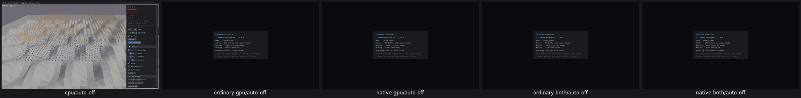
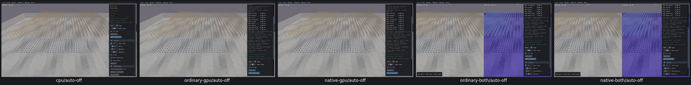

# UI29 — Allow Auto Generate to stop during GPU regeneration

- [x] Fixed and verified locally on all four GPU routes against real Box3D CPU.

Mesh Drop's original Auto Generate off clicks targeted the current button rectangle, yet activated only once and kept recreating bodies. All four GPU captures showed preparation; CPU stopped normally. Loading-only frames used the sample's ImGui context, allowing input to be consumed while the button was absent.

The [UI25 loading-context repair](UI25-repair.md) keeps the sample's pending input and active widget intact while preparation renders in a separate context. Actual current-target off clicks now activate the original button and stop body creation/destruction and ID changes on all four GPU routes. Counts, pause/defaults, scene changes and picking remain valid. The [acceptance receipt](ui29-acceptance.json) records the inputs and effects.

The diagnostic saved-position trace and the first repaired ordinary-GPU run used an obsolete button position after its layout shifted by 96 pixels. These are invalid button stimuli, not matched before/after cause proof; the false predicates remain preserved. A distinct ordinary-GPU check used the current rectangle, recorded two original Button activations and stopped creation/destruction/IDs in 5.47 seconds. The other three GPU routes passed on their first repaired attempts. Original full-review current-position failures remain valid. The shared-context cause for UI29 is an inference from those failures, the loader source and repaired behavior; the exact original event trace is unavailable. See [target adjudication](ui29-trace-target-adjudication.json).

CPU-first before/after grids were inspected. This shares UI25's three-module/four-link repair and cleanup: 26 recorded PIDs absent, no owned cores, zero measured cache growth, 22,162,961 bytes selected evidence across the batch. Box3D/WASM/Rust/WGSL/shared archives are unchanged. No solver or full query qualification is claimed. Final PR10 compatibility, recordings and criterion audit remain open; no commit/push.
