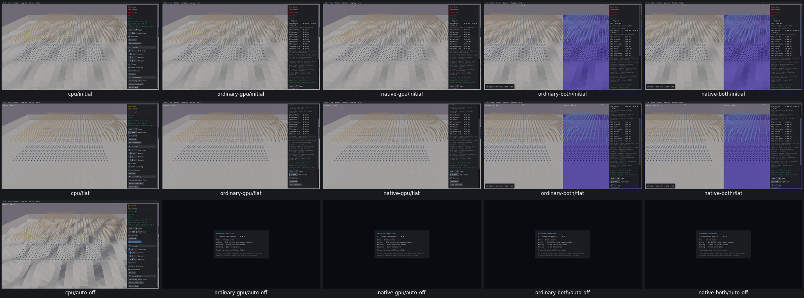

# UI29 — Mesh Drop cannot switch Auto Generate off during regeneration

- [x] Fixed and verified locally; original diagnosis below is historical.

Real CPU activates both requested 50ms clicks and stops regenerating. All four GPU routes activate only the first button, so creation/destruction continue while paused after the requested off click. A distinct input-duration check held mouse-down across two UI frames before release; it also failed on all four GPU routes. Original inputs, button activation history, body counts/IDs and both failures are preserved in [acceptance](mutation-force-acceptance.json).

All eight GPU off captures show the Preparing Simulation screen; CPU keeps the scene and controls visible. The loading host skips normal DrawUI while preparing. This is direct visual evidence of repeated preparation during regeneration, but the exact event-to-button path is not yet traced. Two UI frames need not mean two interactive Info frames.

The first observed missing boundary is the original ImGui Button return, before the sample toggle. Cause remains untraced. Missed input, transient layout and loading/event handling must be distinguished; a relationship with UI25 is only a hypothesis. No further unchanged retries or product fix were made. Trace actual events and intermediate UI state during repair after review.

Verified repair: [Auto Generate off during GPU preparation](UI29-repair.md). Shared UI25 loading-context repair preserves sample button input. Current-position off clicks activate original button and stop actual creation/destruction/IDs allfourGPU routes; CPU reused. Original fullreview failures valid; diagnostic stale-position flags preserved, distinct5.47s ordinary current-target supplement. UI29 cause inferred from loader/source/original valid failures and repaired behavior; exact original event trace unavailable.
