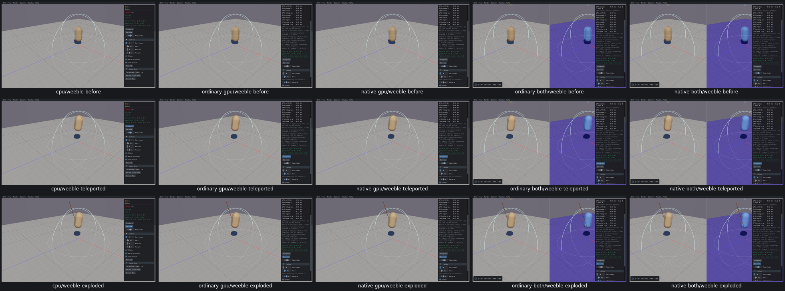
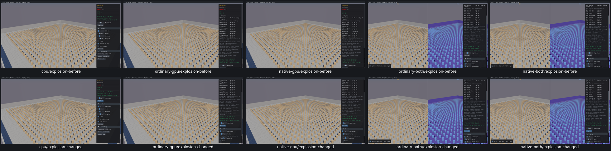
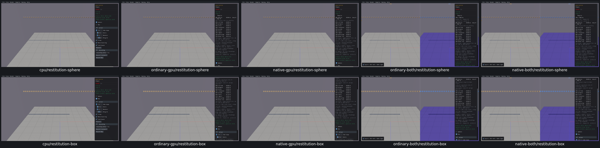
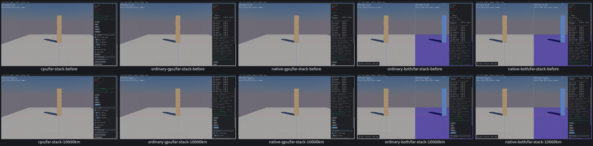

# Body mutation controls

**8widgetentries on4samples reviewed all5routes**, real Box3D CPU first: Weeble teleport/explode/magnitude, Benchmark Explosion magnitude/explode, Restitution sphere/box, Far Stack's one loop call site/all5presets. [Acceptance and original harness adjudications](body-mutation-controls-acceptance.json). No new product finding or repair.

Teleport preserves body IDs/velocities, applies exact source position/native quaternion and wakes. Zero explosion has no velocity effect; positive lifts and negative pulls Weeble; one actual step shows movement. Benchmark defaults and changed magnitude affect actual native/GPU body velocities without mesh physics. Restitution replaces40dynamic bodies per owner, retires old IDs and preserves source positions, size, restitution gradient and ground. Far Stack rebuilds at all five absolute offsets and aims the camera, then restores origin.

The original observer retained warm-world IDs when slots were reused. Twelve false predicates are retained and adjudicated: complete small fixtures can be recovered by unique ID/latest creation; one readonly CPU recovery confirms full baseline counts and completes the unfinished Restitution restart. Native b3ComputeCosSin is the correct quaternion reference; JS Math.sin was not. A duplicate screenshot filename aborted CPU Restitution after the positive toggles; no passed action was replayed. Far Stack uses world token generation for world lifetime, since body triples can reuse slots.

Original CPU Explosion duplicate aggregate sums/counts are not valid quantitative outputs. Actual individual velocities and zero/nonzero/direction/finite behavior still prove the intended immediate effect. All16GPUfixtures pass with corrected unique lifetime tracking; no physics/trajectory equivalence claim.

These are captured interaction states, not repair before/after images. Current totals97/342widgets reviewed245left;117/165sampledispositions48left;10/23customgroups13left;16issuesopen/2earlierfixesverified. PR10unchecked.
