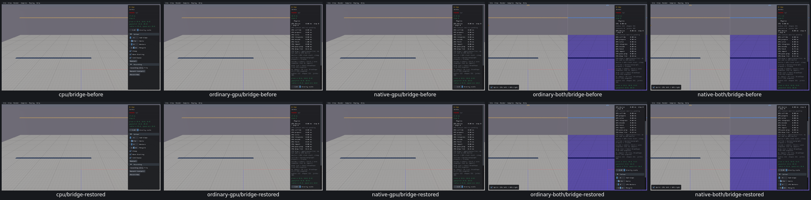
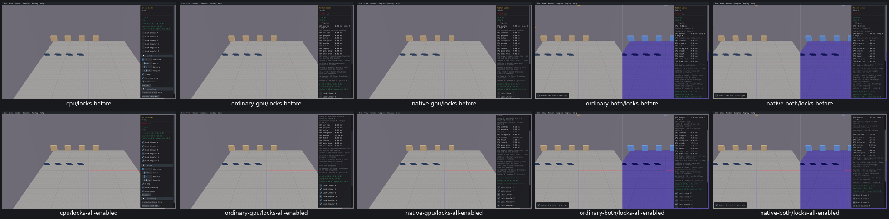
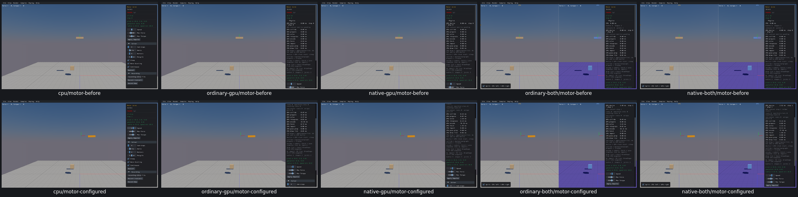
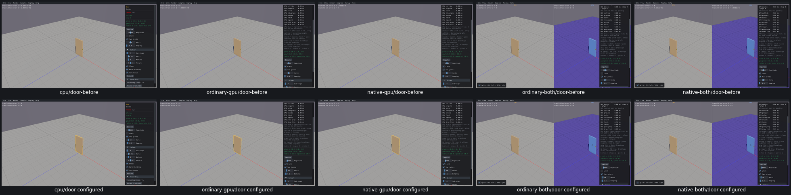
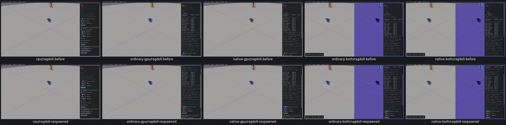
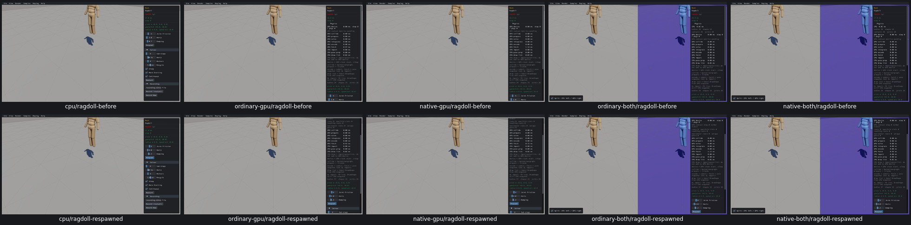
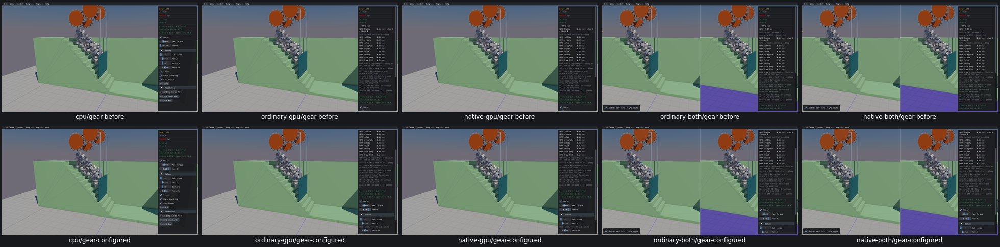

# Body property and remaining joint controls

**28widgets across seven samples and Door MouseDown reviewed allfive routes**, actual Box3D CPU first. [Acceptance](body-properties-controls-acceptance.json):686per-receipt distinct finalcheckkeys;33findingevents grouped into UI21/UI22(26events) plus7harness assertions explicitlyadjudicated. Repeated Door toggles reusekeys; this is not one key per historical evaluation.

Bridge150gravity setters/getters/fullaggregates; six locks onfourbodies/lockedstep/restoration; Motorforce/torque/impulse/targettransform andone speed-drivenstep; Doorhinge recreation/tuning/limitpolicy/button/Ctrlclick/selection/Altignore; both Ragdolls jointpolicy/respawn; Geardriver settings and source geometrycounts. Engine/Rust/WGSL/Box3D/WASM inputs unchanged. No mesh/Rain/solvercampaign.

UI21 Mesh ragdoll leaves14valid oldkinematicanchors perrespawn; Box isactuallyunaffected. UI22 Door uninitialized UI limit andhardcoded recreation policy cause mismatches/stickiness. Both remain unfixed. Gearcount273 was a harness omission of the sourcebackwall;actual274matchesfullsource. Both combined pointerhelpers call GPUlowlevel directly, bypassingpublicwrappers; actualGPUbodyvelocities confirmimpulses inbothpanes. Two missing-public-call assertions rejected, originalreceipts retained.

Review states, not repaired before/after. Current202/342widgets reviewed140left;133/165sampledispositions32left;12/23customgroups11left;20issuesopen/2earlierfixesverified. PR10unchecked.
