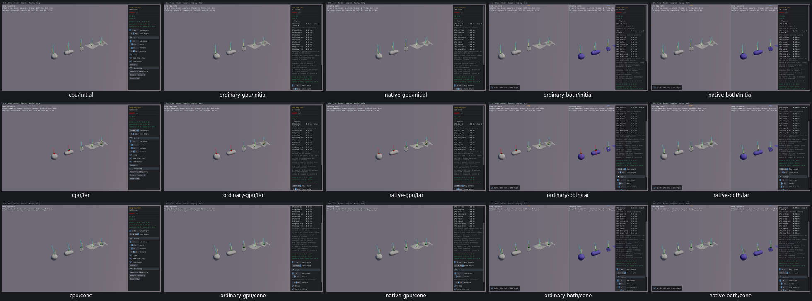
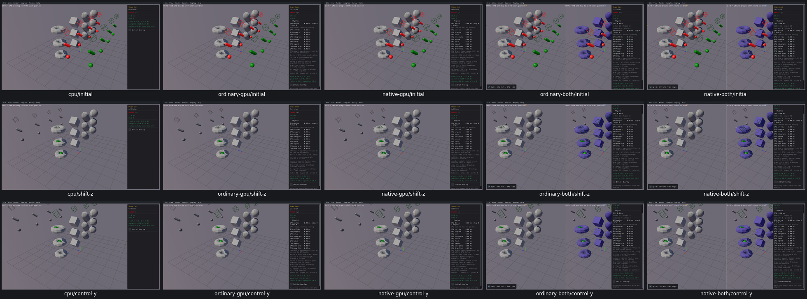

# Cast and overlap controls

14 widget entries and three custom mouse groups across five samples have review dispositions on all five routes. [Actual checks, inputs, original failures and limits](cast-controls-acceptance.json). UI28 records hidden active Box size. [Zero-length initial overlap](initial-overlap-pr11-gap.md) remains a PR11 query finding: the flag reaches the callback context but GPU returns no hit.

CastWorldtypes/callbackpolicy/radius/spawn/destroy/ring64/Ctrlmouse, long-raylength/nativeconeinputs, ShapeCastflag/ShiftZ/ControlY and OverlapWorldShiftZ/release were checked. Reclick-origin and idealcosine predicates were harness errors, corrected against recordednativeinputs withoutreplaying thosecases. Only combinedCastWorldunreachedtailran afteroriginal16MiBoutputcaps; no fullcasereplay.

The visual review also confirms [Overlap World query outcome gap](overlap-world-pr11-gap.md): identical shifted last box proxy yields one CPU callback and zero on all four GPU routes. Mouse/proxy motion works; query result remains an explicit PR11 release blocker. [Both query findings](cast-pr11-query-findings.json).
