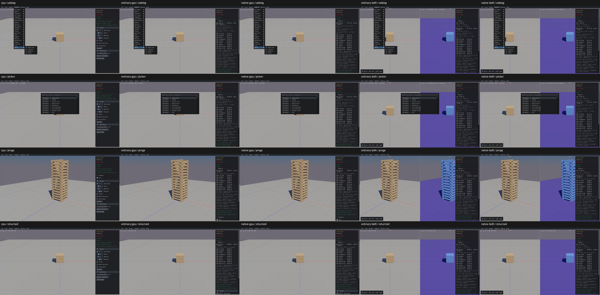
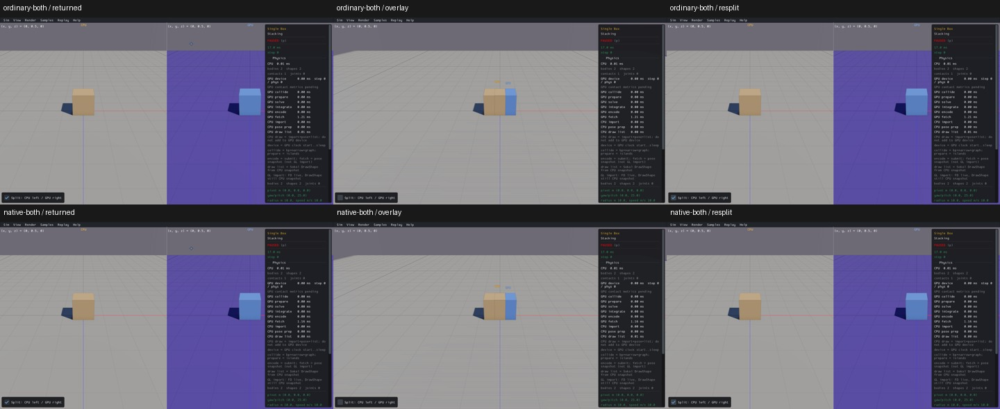

# Full catalog navigation and comparison layout

All 165 native registrations and their 22 Samples-menu categories match the CPU inventory on real CPU, ordinary/native GPU and both combined routes. The actual picker also emits the same 165 identities. Up/Down changes its highlight, search shows the expected Jenga result, and mouse selection commits it.

Factory/lifecycle checks create Jenga (61 bodies/shapes), return through Samples → Single Box (2), use Next → Sphere Stack (31), then Previous → Single Box (2). Each selection creates a new world lifetime and retains solver defaults. Dump Mem Stats emits actual CPU allocation details or explicitly scoped native GPU primary-buffer/capacity data. [Exact entries, transitions and output](catalog-controls-acceptance.json).

CPU first; rows menu / picker / Jenga / returned Single Box:

Both combined viewers also switch split → overlay → split through the actual checkbox. Actor centroids confirm real CPU left/GPU right in split mode and both centered in overlay mode; world identity and body/shape counts stay unchanged. This closes the generated checkbox's layout interaction; its remaining-while-hidden defect is UI05. Picking/dragging in these modes still needs its separate checks.

No builds or production/engine changes. All five apps quit cleanly in 17–21 seconds each. Full observer/API streams were cleaned after extracting names, state transitions, actual memory output and selected images. This qualifies catalog/navigation and a shared layout control, not all sample-specific widgets: full interaction reviews remain 0/165.
