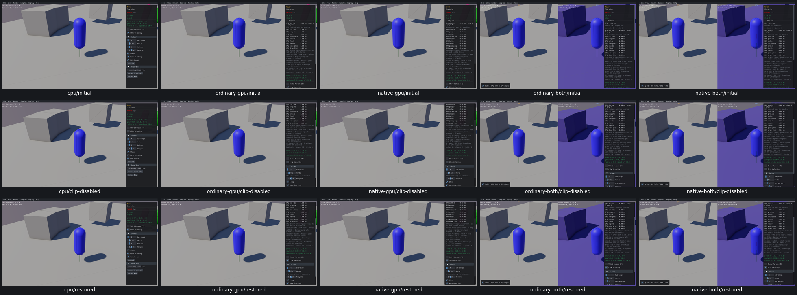
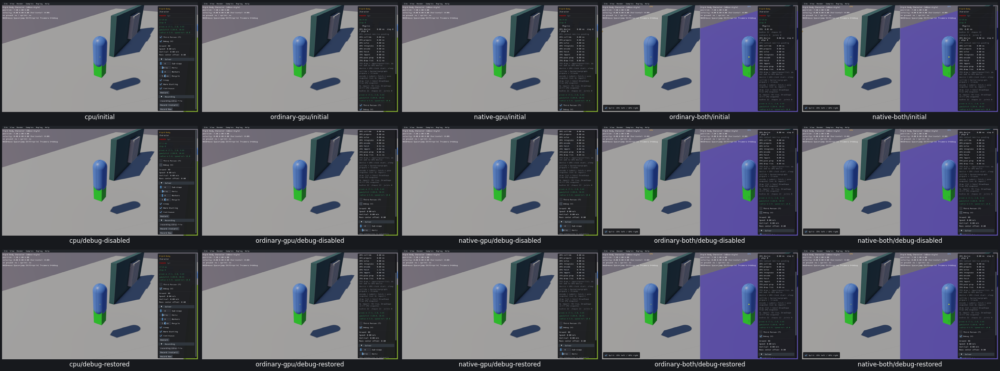

# Character camera, clip and debug controls

Four widget entries and two custom Keyboard groups pass on all five routes. [Actual input/effect/identity/lifecycle evidence](character-controls-acceptance.json). Camera checkbox/T down/up changes actual camera state and follows the same-frame mover or body position. Clip Velocity reaches the actual mover Step argument; Debug and V remove/restore actual debug lines and points. Restart restores native defaults and exiting the sample restores orbit mode. Pausedworldphysics; virtual/nativecharacter UI-frame logic still runs. No movement/jump/sprint physics or query-numerical claim.

