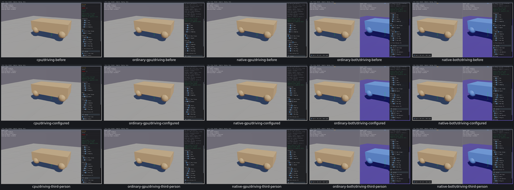
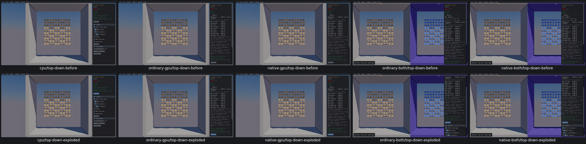

# Driving and Top Down Friction controls

**13widgetentries, one custom Keyboard sample group, allfive routes**, actual Box3D CPU first. [Acceptance](driving-controls-acceptance.json) records381evaluations:371true (including one initial host-only selection check),10UI20policyfailures retained from the failed TopDown waiter. Actual CPUDriving passes were preserved; only unfinished CPU TopDown andunlaunchedGPU fixtures ran after correction.

Driving suspension settings update allfour wheels; steering settings correctly update onlyfront wheels. The related steering-damping check excludes Driving fromUI19 onallfive routes. Speed40 is used by W/S to produce rear motor commands -40/+40; A/D produce front steering targets±pi/4; releases restore neutralcommands. Third-person checkbox/T press-release toggles, camera-follow pivot, picking exclusion and restart are checked. MaxTorque25 leaves actual wheel limits5 and no setter call; [UI20](UI20.md) remains open.

Top Down Friction Explode sends the actual source inputs (position0/10/0, radius10, falloff5, impulse10000), changes actual outward velocities, preserves IDs/pausedposes, remainsfinite and restarts atrest. These are pausedcommands andimmediateimpulses; no new physicsstep or solver qualification.

Interaction states, not repair before/after. Current totals174/342widgets reviewed168left;126/165sampledispositions39left;11/23customgroups12left;18issuesopen/2earlierfixesverified. PR10unchecked.
