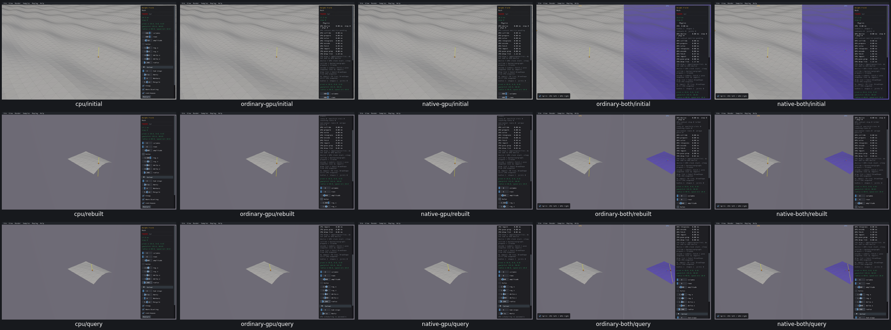
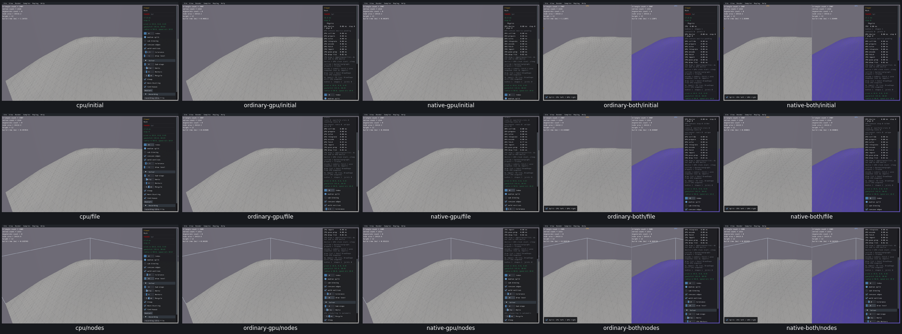
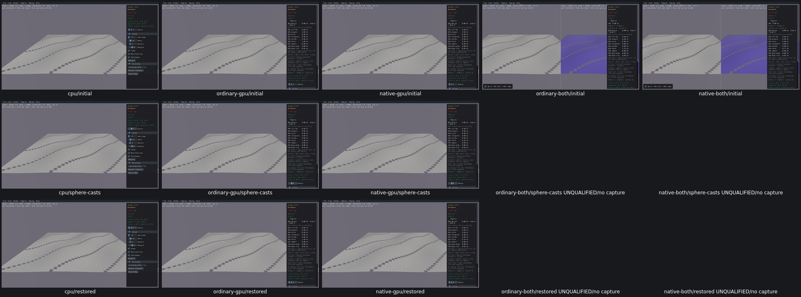

# Height Field and Mesh Viewer controls

17 widget entries / three samples have explicit review dispositions on all five routes. [Acceptance](geometry-controls-acceptance.json) records [UI24](UI24.md), [UI25](UI25.md), five rejected serialization predicates and combined benchmark performance limits. No product repair.

Mesh Viewer file selection/build policies/node overlays pass actual getter/input/lifecycle checks. Height Field dimensions, amplitude, holes, query inputs, ray/sphere branch and preview are checked; zero amplitude removes GPU floor. Typing.75afterzero applies.7onall4GPUroutes. Benchmark Radius0/.4/.1passesCPU/standaloneGPU; combinedraytransitionpassesbuteditingbacktoapositivevalue/reset/quitremainsunqualifiedafter100sbudget. No further retry; PR08performanceoutlier, noPR11querynumericscampaign.

