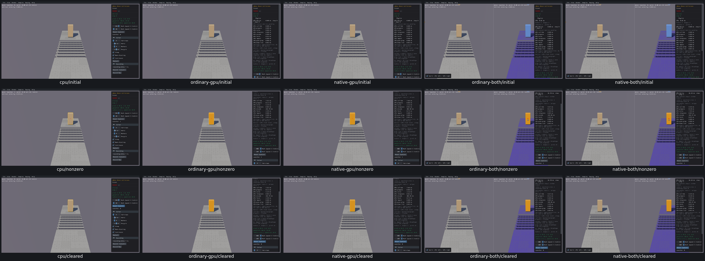

# Ghost Collisions controls

Both Walk Speed sliders and Reset Counters have actual input/effect checks on all five routes. Native float32 inches-to-meters conversion reaches horizontal velocity while paused, preserving vertical velocity, geometry and body identity. Reset clears actual nonzero launches, worst-speed HUD and drawn markers, preserving bodies. [Acceptance and original inputs](ghost-controls-acceptance.json).

The first CPU2/4/8pixel mouse-grab inputs raised the center above the native grounded threshold, so no counter increment was expected. Those failed test preconditions are preserved. A distinct one-notch camera zoom and one-pixel real upward grab produced a nonzero counter on every route after one native single step. No private state injection or solver repair. Earlier CPU slider passes were reused.

