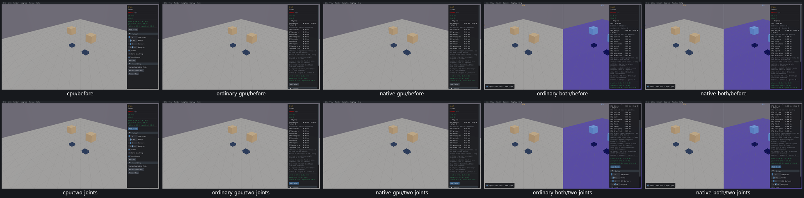
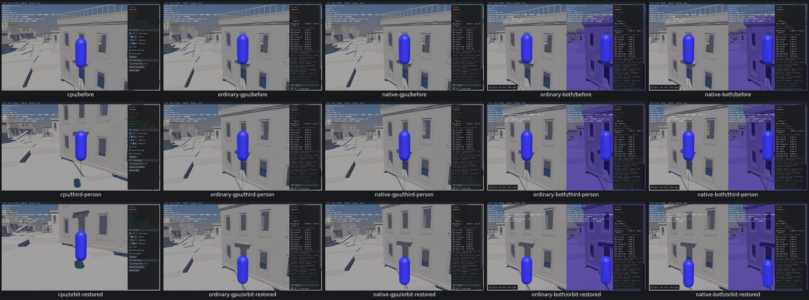
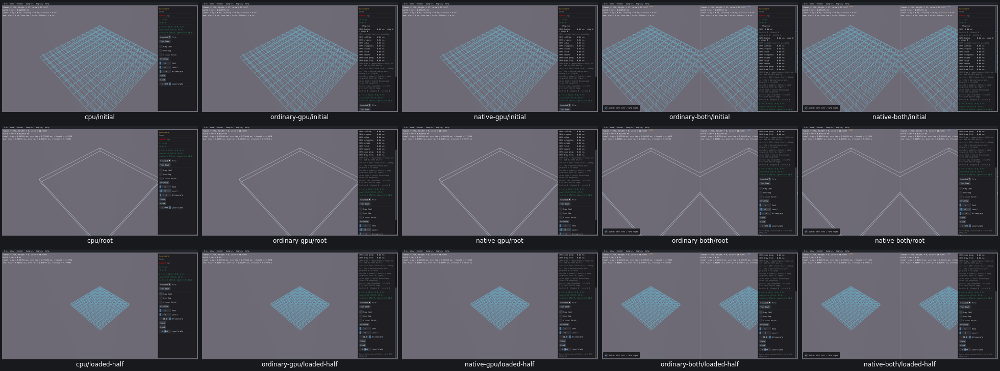
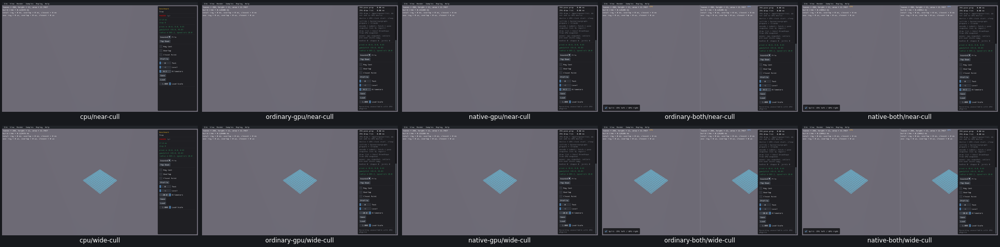

# Joint, camera and tree controls

13 widget entries / three samples plus Village KeyboardT reviewed on all five routes, real CPU first. [Acceptance](host-controls-acceptance.json). No new product issue or repair.

Crash Add Joint creates real welds between the two original bodies, retains geometry/IDs and resets cleanly. Village T press/release changes actual camera mode, screen HUD and same-frame mover-follow pivot; static body identity stays intact. Tree exercises all12controls, actual query/build/draw effects and private Save/Load with half-scale geometry. Focused wheel/culling inputs demonstrate an actual draw-count change that the default-camera fixture could not expose.

Original invalid HUD/camera/empty-world observer expectations are retained and adjudicated; no product failure inferred from them. No solver, query numeric accuracy, trajectory or release performance qualification.

