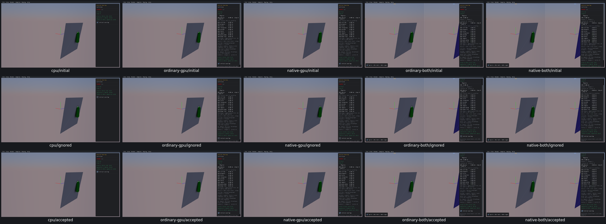

# Zero-translation initial overlap — query finding for PR11

The Initial Overlap checkbox reaches the actual native CastContext on all five routes. With it true, real CPU accepts one zero-fraction overlap; all four GPU routes report zero callbacks and accepted hits. Input origin, zero translation, capsuleproxy and actualbody/mesh setup are retained in [acceptance](cast-controls-acceptance.json). Geometry/IDs are unchanged. This is a confirmed query outcome gap, not a successful GPU feature check. Its calculation cause is untraced; numerical query investigation and repair remainPR11. No engine change or hidden pass.

