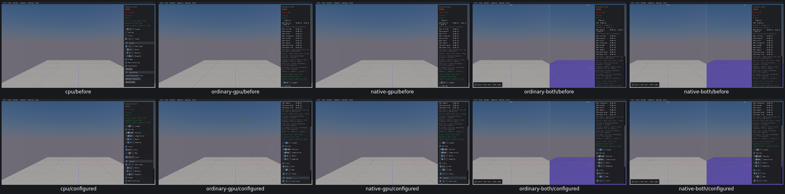
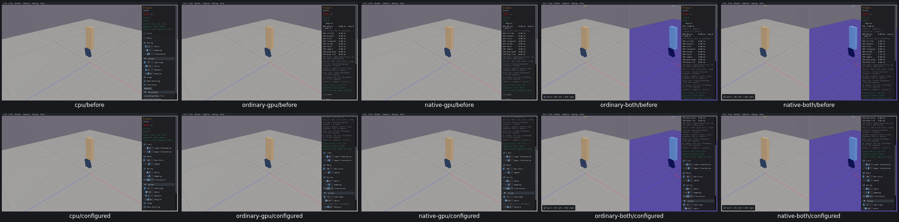
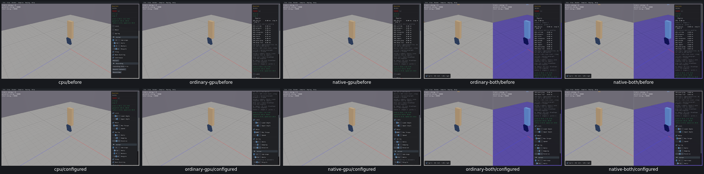
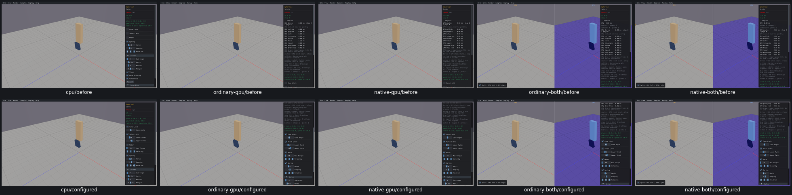
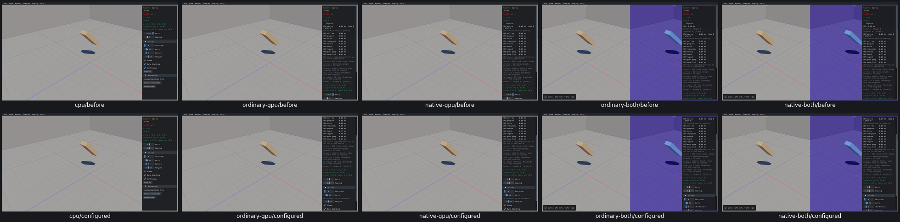
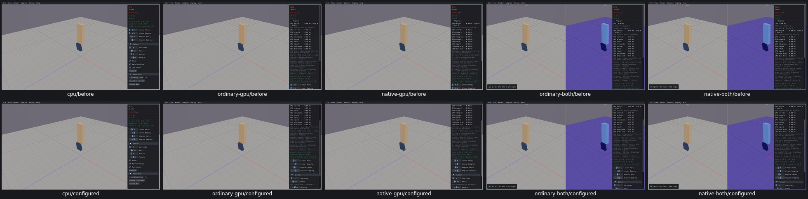
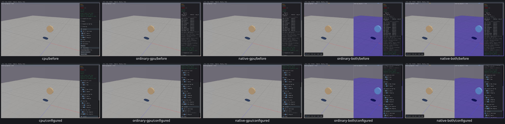

# Joint control review

**64 widget entries across seven samples reviewed on all five routes**, real Box3D CPU first. Distance10, Prismatic10, Revolute10, Spherical12, Parallel Spring2, Weld4, Wheel16. [Actual state/effect/identity acceptance](joint-controls-acceptance.json):2355recorded checks,2345true and10policyfailures grouped into UI19. No product repair.

Every conditional slider/toggle and all Spherical vector components were exercised. Actual original setters/getters establish the intended joint policy, wake calls and retained IDs. Distance Count retires old joints/bodies, creates three dynamic bodies/joints with current policy, and preserves source positions. One configured step produces finite body results and motor/spring response where expected. Every sample restarts to original actual settings/counts. This qualifies controls, not numerical solver/constraint accuracy or trajectories.

Wheel steering damping is confirmed wrong on allfive routes: UI1.4, actual steering.7; it calls the suspension setter with1.2. [UI19](UI19.md) remains unfixed. Closely related Driving has the correct source call but runtime remains unreviewed. Parallel Spring default10Hz versus drag range0..5 is recorded as a range observation; default is unchanged and text entry can exceed drag range.

These are default/configured interaction states, not repaired before/after. Current totals161/342widgets reviewed181left;124/165sampledispositions41left;10/23customgroups13left;17issuesopen/2earlierfixesverified. PR10unchecked.
