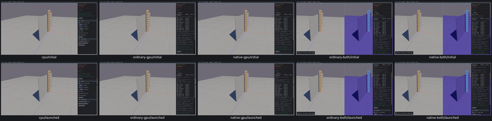
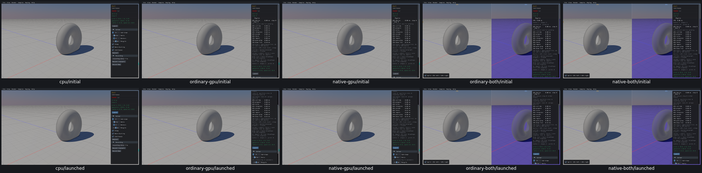
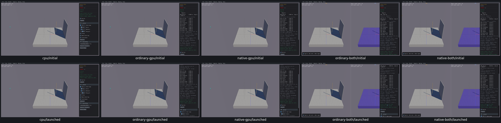

# Launch controls

Four widget entries across three samples reviewed on all five routes, real Box3D CPU first. [Acceptance and original receipts](launch-controls-acceptance.json).

Bullet vs Stack: Launch/relaunch and L press/release create the correct bullet, retire its predecessor and retain the stack/ground IDs and poses. Stall: Launch/relaunch replaces the rock with stable scene counts and source bullet/shape/angular velocity. Sensor Hits: Bullet changes the next launch policy; the existing body stays unchanged. Launch and held B replace the projectile; release stops polling launches. Restart restores defaults.

The Stall velocity assertion compared body-origin input with shape-attached centre-of-mass velocity. All routes return the same actual CPU velocity; the source explains the mass-centre adjustment. Original false assertions are retained without rerunning. No new product issue or repair. No physics steps or CCD/sensor-event/performance qualification.

