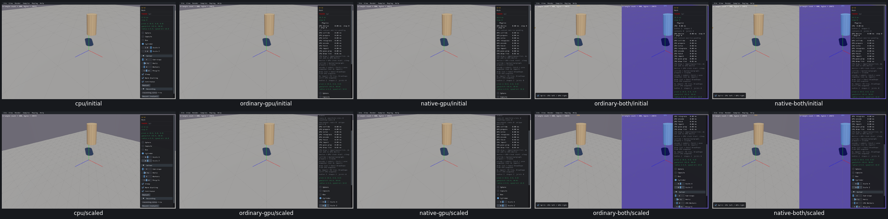
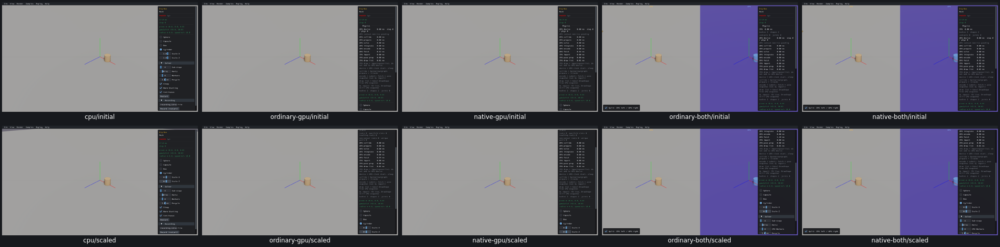
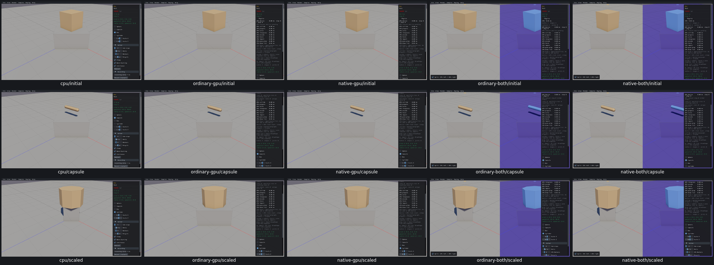
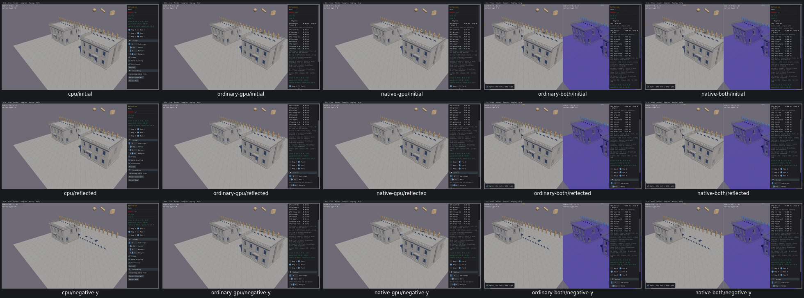

# Mesh controls

24 widget entries / four samples have review dispositions on all five routes, CPU first. [Acceptance](mesh-controls-acceptance.json) includes [UI23](UI23.md) and explicit STARTUP01 loading exclusions; these are not24 feature passes.

Shape getters, source body poses, retirement/replacement and retained static IDs were checked. CPU Capsule dimensions pass. Eight GPU Capsule transitions timeout; a native boundary probe shows creation returns and captures collide_pairs shader loading. Untouched controls were completed separately. No cold campaign resumed.

Zero scale leaves actual GPU geometry unchanged in Grid, Big Box and Box on all4GPUroutes. Combined GetMesh reads CPU and hides the failure; actual GPU AABB proves it. Reflection ±1 signs pass all5routes. No product repair yet; no physics/CCD/query/performance qualification.

[Native loading capture](evidence/capsule-boundary-runs/native-gpu/capsule-created.png).
