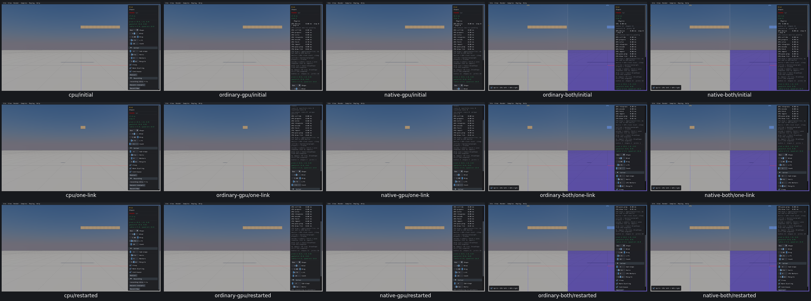
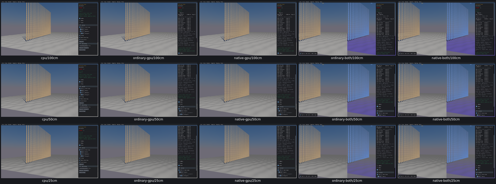

# Regeneration and Wind control review

13 widget review dispositions across three samples on all five routes. [Checks, original probe errors, actual inputs, failures and limits](mutation-force-acceptance.json). UI29 records Auto Generate off failing on four GPU routes even with longer input. Existing standalone default-filter discrepancy remains PR02.

Mesh Drop actual1024body regeneration, all1029shape filters, four types, floor amplitude and Generate were checked. CPU paused auto recreation starts/stops; GPU off fails. Wind shape/count lifecycle and force arguments were observed after four actual single steps. Falling Trees preserves50trees/1100hulls while changing the ground mesh among60000/240000/960000triangles.

Original probe enum/default-filter/AABB assumptions were corrected against source and retained data without replay. No product or engine fix.

