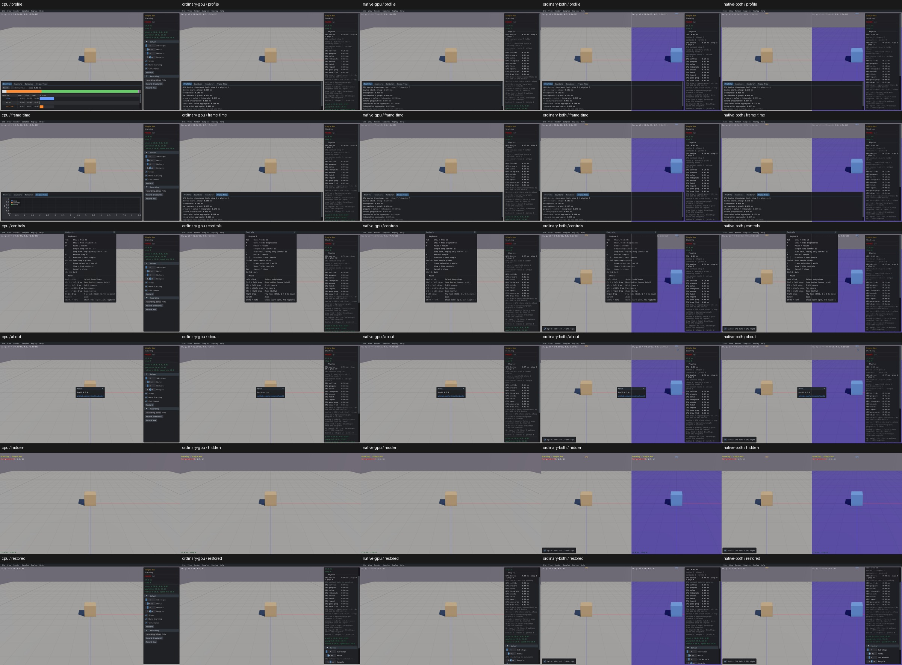

# Navigation, diagnostics and UI visibility

Reviewed actual inputs on real CPU and all four GPU routes: Profile/Renderer/Frame Time tabs, CPU plot toggle/subtree controls, CPU Profile Reset, shared Reset Profile menu, Help Controls/About and Escape, Solver collapse/reopen, R restart from world and Info focus, Hide UI and Tab restoration. Restart changes world lifetime intentionally and preserves body/shape counts and default settings. [Exact state/window evidence](navigation-metrics-acceptance.json).

The native GPU Profile and Frame Time views both show actual device timestamp tables. CPU substage timings/plots/reset/tree controls are explicitly unavailable; Frame Time currently has no native history chart. This presentation difference is recorded rather than pretending the CPU plots were tested on GPU.

Two visual defects were found and left unfixed: [CPU Profile label clipping](UI04.md) and [hidden HUD/control overlap](UI05.md). The inputs and main-window visibility work; those visual defects prevent a complete usability pass. A table reachability suspicion was a two-detent harness overscroll and was disproved by a one-detent CPU control. Completed CPU navigation/help/restart checks were reused, while only the tree control was repeated; four GPU routes used the correct native Profile availability.

CPU first; rows Profile / Frame Time / Controls / About / hidden / restored:

The inventory now has 85 shared calls: 84 upstream CPU calls plus one combined-only split checkbox emitted from Python. The source generator now inventories that emitted call through its Python AST; all 165 sample identities, 342 sample widget calls and prior review statuses are preserved. Native split interaction itself is still pending. Full sample interaction reviews remain 0/165. No engine or production source was changed for this batch. Consumed world/API streams were cleaned, with original screenshots, compact effects and one current viewer pool retained.
