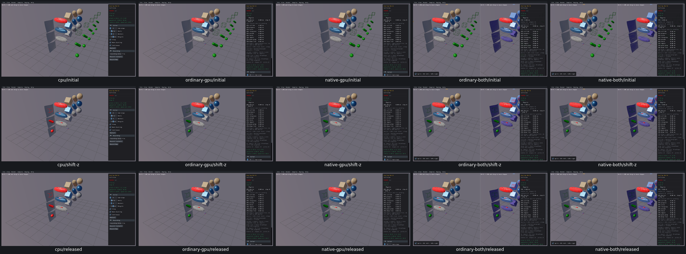

# Overlap World — query outcome gap for PR11

After Shift-drag moves the proxy fromZ=-5toZ=0, the actual last eight-point box overlap query has identical inputs on all five routes. CPU invokes the overlap callback once, which returns false to stop and sets the preview red. All four GPU routes invoke it zero times and keep the preview green. Static/dynamic scene bodies and IDs are preserved. [Actual query inputs/callbacks and body digests](cast-controls-acceptance.json).

This is a confirmed query outcome gap; the mouse handler and proxy movement work. Calculation cause is untraced and belongs toPR11. Do not treat this as a matching collision result or undertake a query repair inPR10.

