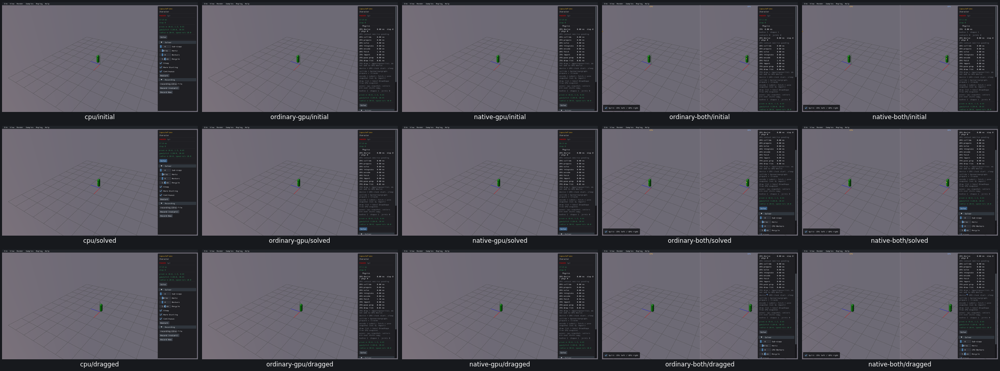
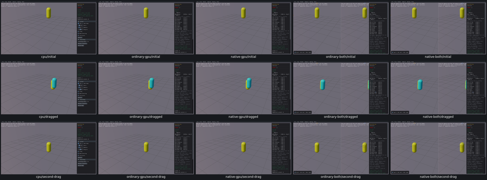
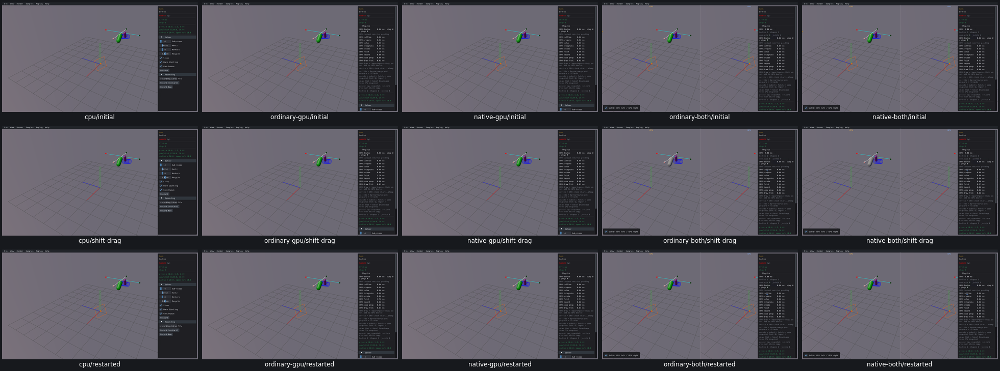

# Capsule plane and body cast mouse controls

One Solve widget and three custom mouse groups have review dispositions on all five routes. [Actual query/solver/draw/identity checks and limits](plane-controls-acceptance.json). CapsulePlane applies the actual returned plane-solver delta; MoverOverlap encounters positive planes and shows queried/solved poses. Mouse translation, release and Alt-ignore gates pass. Bodies/Cast changes the actual ray/shape query transform and preview only under Shift; Control/unmodified/AltShift are ignored, physics body IDs/poses unchanged.

Two combined preflight count assumptions and one initial empty tool capture were harness failures; original receipts and source-based resolutions remain. Combined BodyCast queries dispatch only throughGPU/public. No numericalquery or physicsqualification.

OBS01 is an unconfirmed appearance flag: a small shape appears pale/white in the combined Shift-drag captures. Selection/material provenance was not retained, so the input/transform passes do not certify its color. Triage before final acceptance; no new confirmed issue group is claimed.
