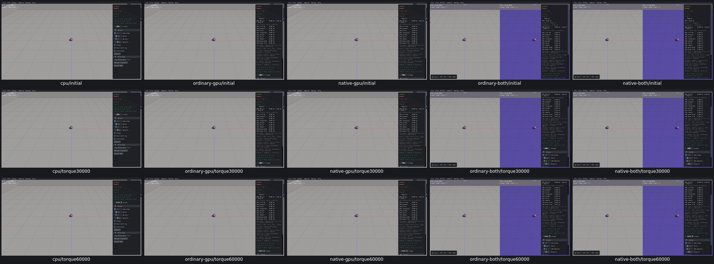

# Mesh Scale and Contact torque controls

Seven widget entries across two samples have review dispositions on all five routes. [Actual input/effect evidence and limits](query-input-controls-acceptance.json). Mesh Scale confirms knownUI23zero-scaleGPUrejection and newUI27misplacedpreview; signed scales/origin/ray-spherebranch/identity/restart checked. Contact torque0/30000/60000actually reaches ApplyTorque with the expected vector magnitude/body/wake; Wrelease stops calls whilepaused. No physics/contact-event or query-numerical qualification.

