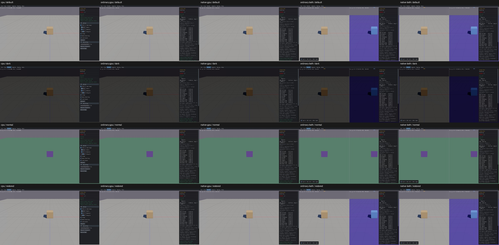

# Shared Render controls

Verified on real Box3D CPU, ordinary/native GPU and both combined viewers: 12 renderer settings change and restore at the actual `RenderFrame` boundary, and all five debug modes reach `FrameInput.debugMode`. Fifteen Render submenu call sites plus the top-level Render menu now have reviewed dispositions.

Mouse input checks cover shadows, GTAO enable/quality, IBL, hull edges, edge convexity, shadow split start/range/distribution, exposure and sun. Quality changes from the actual initial tier 1 to tier 2 and back. The native host does not enable ImGui keyboard navigation, so Combo selection uses the actual popup cursor/font/row geometry and mouse input. This is a harness correction, not a production keyboard-navigation repair.

Exposure changes from -2.5 to -6 and back; the selected scene region's mean brightness falls from about 158 to 55 on standalone routes. Normal mode changes the actual image and all settings restore. World/body/shape identity and counts, solver settings and pause state stay intact. [Acceptance and exact boundary states](render-controls-acceptance.json).

CPU first; columns CPU / ordinary GPU / native GPU / ordinary combined / native combined. Rows default / darker exposure / normal debug mode / restored:

CPU evidence combines retained partial checks and two focused tail checks on the same frozen build/default setup. Original failures remain failures: negative `xdotool type` text needed an option terminator; the first exposure stimulus was only half a stop and did not satisfy the chosen 15% contrast gate; the first quality selection chose the existing tier, then keyboard navigation failed to change it. The final check preserves the contrast gate with a larger stimulus and requires a real quality change through mouse input. Passed CPU controls and debug modes were not replayed as full runs. Four GPU routes were launched only after the corrected CPU tail passed.

No engine, WASM, Box3D or production UI source was changed for these checks. Full streams and superseded binaries were cleaned after extracting settings and media. Selected image effects and actual renderer parameters are qualified; this is not exact pixel matching or a repair of UI03's missing GPU debug overlays. Full PR10 sample interaction coverage remains open.
