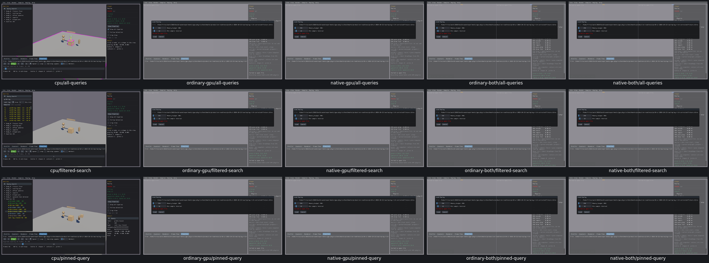
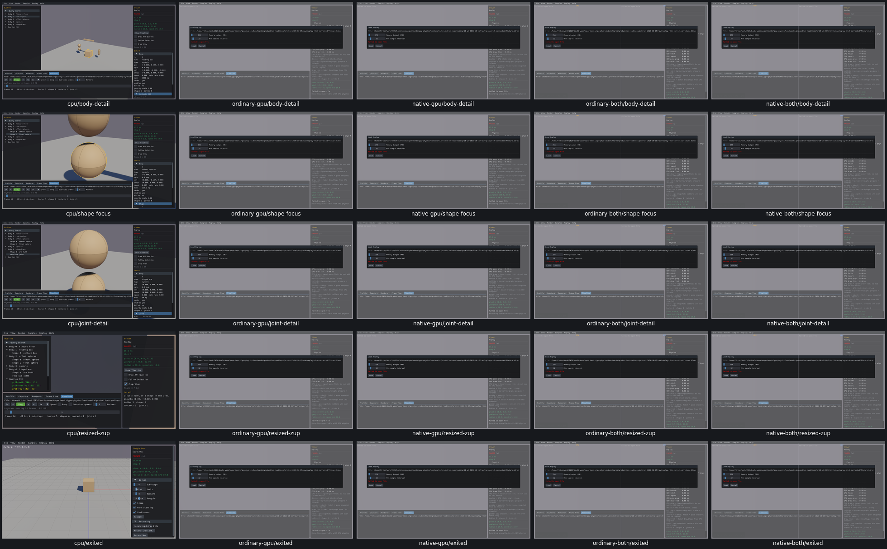

# Remaining Replay query and selection controls

The remaining19 widget entries and the Replay custom input group have actual CPU checks, with all four GPU loaded-player routes explicitly unavailable under UI09. [Actual calls, input, identities, rendering effects, failed probe assumptions and limits](replay-final-review-acceptance.json).

Query search/index/filter/rebuild/result pin/draw callbacks, body/shape/joint/contact details, Follow/Z-up, actual viewport picking and gated inputs, F focus paths, resize/layout and exit restoration were checked. The original immediate text read lacked a stable-value wait; retained native history/search results and the narrow pre/post-Enter probe confirm correct text. Two shape expectations assumed creation-order slots, while native enumeration returned the first sphere at slot1; actual label/id/AABB/focus were consistent. No new product defect or fix.

