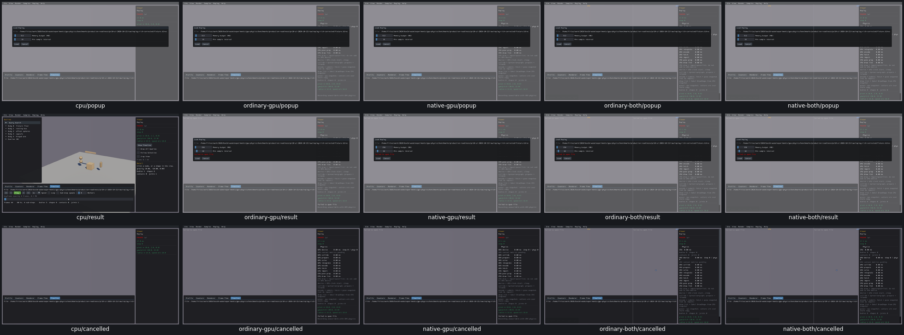

# Replay load-policy popup

Memory budget, minimum interval and Cancel have review dispositions on all five routes. Native --replay opens the real sample and popup. CPU Cancel followed by R preserves the original persisted policy; CPU Load applies128MiB/8frames, pre-generates the64-frame recording and restores frame0. GPU popup input/cancellation works, but its native player remains explicitly unsupported and UI09 still mislabels that as a file-open failure. [Actual policies, controls, exclusions and cleanup](replay-popup-acceptance.json).

Two GTK automation attempts stopped before any widget: the first failed discovery; the second found/focused the owned chooser and submitted a path, but it did not close. OBS02 remains an unconfirmed probe/environment flag for final triage; the native supported CLI path lets the widget review continue without fake state injection. No product fix.

