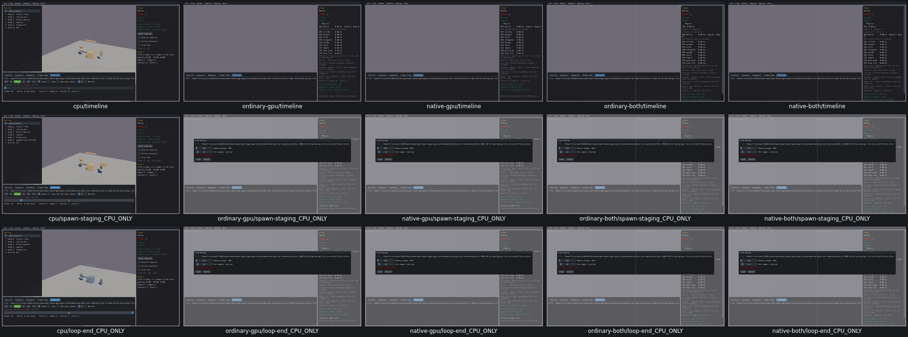

# Replay timeline controls

Seven widget dispositions: Show Timeline, Timeline tab, Speed, Loop, Sub-step spawns, Workers and frame scrubber. Actual CPU player calls/frames/creation staging/worker state/body identity were checked. The Timeline tab also works on all four GPU routes; loaded-player controls remain explicitly unsupported under UI09. [Checks and source/data adjudication](replay-timeline-acceptance.json).

Comma, Shift-comma, backward clamp and Ctrl/Alt gating were checked. Two original probe assertions were wrong: an unchanged frame0 edit needs no new Seek call, and the4x window reached EOF. Retained native action advances24frames over6display frames at4x before EOF, so no rerun was needed. Full custom mouse/focus/layout review remains open.

