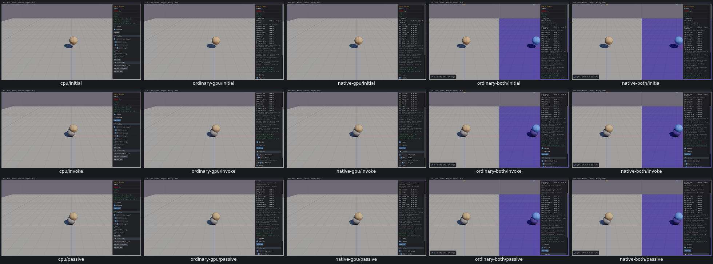

# Overlap Recovery and Static Invoke controls

11 widget entries across two samples have review dispositions on all five routes. [Actual checks, inputs and limits](scene-controls-acceptance.json). Static Invoke deferred flag/creation/destruction preserve original body identities. Overlap Recovery changes actual hull sizes/counts/overlap positions and contact-tuning arguments, with dynamic recreation and restart.

UI25 also appears here: typing.25applies.2inall4GPUroutes; CPUapplies.25. Remaining controls pass with one-character settings. Shared cause untraced; no repair or typing-rate claim.

