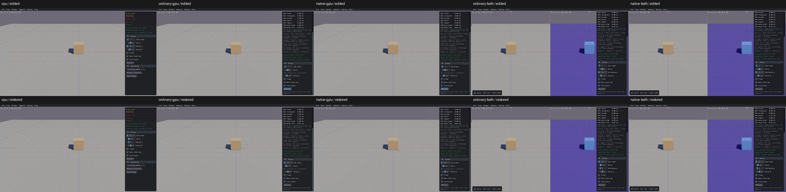

# Shared solver sliders

Four shared slider call sites verified on the five supported native viewer routes with real Box3D CPU first. [Actual API argument receipts](solver-controls-acceptance.json) contain 100 checks and ten original edited/restored screenshots. Full sample interaction coverage remains open.

- Hertz and Sub-steps: edit to 120 Hz / 7, single-step once, record actual `b3World_Step`, GPU step and combined CPU step arguments; restore 60 Hz / 4 and verify actual calls again.
- Recycle: edit to 3.5 cm, record 0.035 m in the actual public/GPU/combined-CPU setters; restore the initial 5 cm.
- Workers: real CPU and combined CPU Workers edits recreate the world, retain edited solver settings, and restore 8 workers. Standalone GPU explicitly reports automatic scheduling and has no Workers slider. Native GPU recording is explicitly unavailable.

The first GPU harness incorrectly expected the CPU Workers label on standalone GPU. The first combined harness checked for its widget during the real asynchronous loading transition. Original failures remain; corrected protocols reconcile generated availability and wait for resubmission within the existing 25-second readiness bound. A prelaunch Python syntax error launched no viewer. No engine or production code was changed for these slider checks, and passed CPU/standalone routes were not repeated. Full streams and superseded viewers were cleaned after compact actual API windows were extracted; the current diagnostic viewer pool is retained for remaining PR10 controls.

This verifies UI state, actual parameter propagation and world recreation. It does not qualify physical solver accuracy or certify every sample-specific widget. All shared-menu, picking and sample-specific entries remain explicitly open unless separately checked in the inventory.
