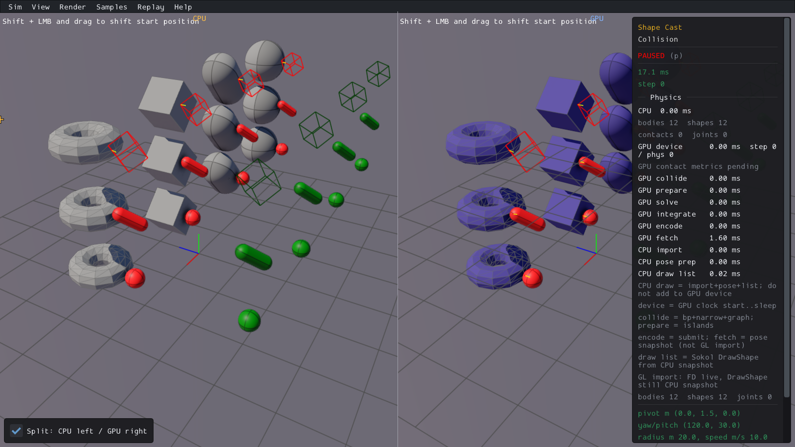

# PR11 — native query behavior and appearance

Verified milestone on `feat/gpu`, 2026-10-17. Real Box3D CPU is the numeric reference; ordinary and native cached GPU backends are checked separately. This closes PR11 only, not production readiness or solver qualification. [Recovery and frozen budgets](log.md).

## Repairs and original evidence

| Defect | Before | Repair / verification |
| --- | --- | --- |
| Mesh overlap and shape casts incorrectly culled back faces / stationary casts | Initial Overlap and shifted Overlap World: CPU callback1, GPU0 on both backends | Remove query-only culls; both exact scene constructions/inputs now callback1 with correct public shape/body ownership |
| Mesh casts replaced witness normals with face normals | Initial overlap got a face normal; edge contacts lost their actual separating normal | Preserve narrow-phase normals, including native zero normal at initial overlap; front/back/moving/stationary controls pass |
| Standalone world shape-cast child metadata | GPU child-1, CPU0 | Match the existing ray callback convention: standalone child0, compound child unchanged |
| Native shape filter default | GPU categoryBits1; CPU UINT64_MAX; mask2/high-bit queries missed | Correct C shim default; default, bit1, bit2 and bit63 filtering pass |
| Height Field cast arithmetic used rounded world coordinates | Frozen CPU/GPU point differences up to0.014739m and adjacent-facet/normal differences | Cast in body-local coordinates shifted to first triangle vertex; advance the relative pose and retain the simplex |

[Original Initial Overlap finding and CPU-first grid](../pr10-ui-2026-10-15/initial-overlap-pr11-gap.md), [original shifted Overlap World finding and grid](../pr10-ui-2026-10-15/overlap-world-pr11-gap.md), [numeric before](baseline-corrected-ordinary.json), [numeric after](repaired-comparison.json). Original CPU, ordinary and native outputs are retained separately. The minimal fixture's original crash was CPU body lookup on GPU IDs; the headless adapter now uses the native viewer's exact forwarding operation. No product crash is inferred.

The actual CPU triangle trace isolates the precision cause: [frozen inputs](triangle-trace-inputs.json), [native C outputs](triangle-trace.jsonl). For case120, merely changing the same CPU calculation from world to local coordinates changes the normal from the old GPU result to the native scene result. Case391 changes the closest adjacent facet in the same way. General solver arithmetic and shaders were untouched.

## Qualification and intentional conventions

- [601 records per backend](contract-comparison.json):180 ray inputs across spheres, capsules, hulls, reflected/nonuniform meshes and height fields in three body poses; callback and actual GPU closest-ray paths; nearest selection in both creation orders; public body/shape identity; teleport, exclusion and destruction; default and original shifted Body Cast explicit transforms. Maximum CPU/GPU component difference3.5e-7, limit1e-5.
- [Nested callback checks](callbacks-result.json): continue, terminate, ignore and clip responses, body reads and nested callback/closest queries on all three routes. Traversal order is not an API promise.
- [216 additional body-mesh cases](encroach-comparison.json) cover encroachment on/off, penetration/shallow overlap/separation, front/back, stationary/approaching/receding motion, clipped fractions0/0.1/1, reflection and explicit rotated transforms. Both backends pass at1e-5,max2.4e-7.
-14,278 frozen Height Field casts and13,340 hits agree on both backends. Of95 residual whole-grid cases,93 choose adjacent edge-sharing facets in different traversal orders (CPU grid walk versus GPU BVH); two use the same facet with different cyclic vertex order/first-vertex anchor. Maximum fraction difference1.8e-12; cast-center travel difference remains below1e-5. Witness points/normals can differ at creases; **whole-grid point/normal identity is not claimed**.
- Each of those95 GPU-selected triangles was fed independently to actual CPU `b3ShapeCast`: all returned points/normals/fractions pass the original1e-5 limit, maximum1.49e-8. [Exact target inputs](facet-oracle-inputs.json), [CPU outputs](facet-oracle.jsonl), [comparison](facet-oracle-comparison.json). This validates the chosen calculation rather than loosening the original tolerances or dismissing the old differences.
- The two same-facet normal differences are traced to CPU heightfield second-triangle anchor `point21` versus GPU mesh import `point22`. [Rotating just that input vertex order in the CPU calculation](vertex-order-comparison.json) reproduces the whole-scene CPU outputs exactly. Geometry and winding are unchanged. The GPU calculation is independently checked with its actual vertex order; this floating-point witness convention is explicit.
- [Frozen CPU arithmetic reference](heightfield-cpu-reference.json) is consumed by the Rust regression. Ordinary and native query suites each pass25 tests, including all14,278 casts,81 affine pruning controls and existing TOI/query regressions. Candidate-pruning equivalence remains exact; the superseded saved GPU outputs remain original evidence.

## Actual native display checks

Two fresh combined viewers each pass14 checks, with actual query results, draw submissions and camera matrices: [ordinary](ordinary-both-visual-result.json), [native](native-both-visual-result.json). Positive hit markers and normal segments use returned values; camera projection places them in the viewport. Body Cast ray endpoints, miss colour, Shift-drag and same-process scene changes pass. No old world-query markers survive the switch to Body Cast.

OBS01 is resolved without a palette repair: the pale sphere is the actual native white **miss** preview. Its draw colour is[1,1,1,1] and its center[-6.5,2.5,0.5]; the frozen shifted query also misses on real CPU. The capsule's colour is a separate overlap result.

CPU geometry is real prefixed Box3D on the left. Combined Step query overlays are shared GPU-result draws, so their independent reference is the CPU numeric fixture, not the left-hand overlay. All eight after images were inspected. The Info panel occludes some right-hand objects; actual draw/query/camera checks supply their numeric evidence. No exact-pixel or chaotic-trajectory equivalence is claimed.

[Initial Overlap after](evidence/ordinary-both/initial-overlap-after.png), [Body Cast Shift-drag after](evidence/ordinary-both/body-cast-shift.png), [all selected media](media.json). No video or full-catalog campaign was needed.

## Limits, reproduction and cleanup

Tested Manjaro Linux, NVIDIA RTX4070SUPER, driver610.57.04, Vulkan compute with native desktop graphics. This is finite query qualification, not broad device/OS, performance, physics or long-window certification. Ray/sweep callback ordering and near-tied mesh facet choice are intentional conventions. Mesh ray casts retain their native sidedness; mesh **shape casts and overlaps are two-sided**. Mover plane/solver qualification and other roadmap items remain separate. PR02's demonstrated filter reopening cause is repaired; its whole gate is not silently certified here. Box3D, WASM and scene geometry remain unchanged.

New orchestration is TypeScript/Bun. Existing native build generators are reused unchanged. All runs have frozen time/process/storage limits in the recovery log. Diagnostic failures (wrong harness body lookup, stale log tail, obsolete UI schema/missing state hook/include) are preserved and never reported as product fixes.

For reproduction, configure an unchanged CPU library under a fresh output directory's `raw/cpu-build` as in the recovery log, build current ordinary/native libraries with `external-c-shim,replay-diagnostics`, then run `GPU_PR11_CHECK_OUT=<fresh-directory> bun experiments/gpu-physics/scripts/pr11-query-check.ts baseline` from the repository root. Follow with `contract`, `heightfield`, `encroach` and `callbacks` using the same output directory. Retained historical results are evidence, not rerun destinations. The focused triangle generator consumes the saved inputs. `bun experiments/gpu-physics/scripts/pr11-viewer-build.ts` prepares the bounded native diagnostic viewers and temporary driver; run `viewer-check.ts` for each route. Fresh run directories are required by the UI driver. Scripts are diagnostics, not publication gates.

The final audit records source/library identities, original-limit results and cleanup. Consumed binaries, CMake trees, full duplicate Height Field outputs and generated helper copies are removed; the compact CPU reference has a named consumer in the Rust test. Shared Cargo/driver/pipeline caches and previous work are preserved. No PR11 commit or push was requested.
